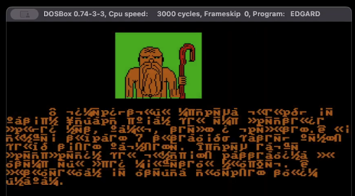
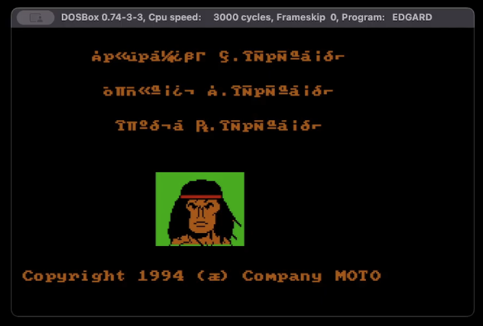
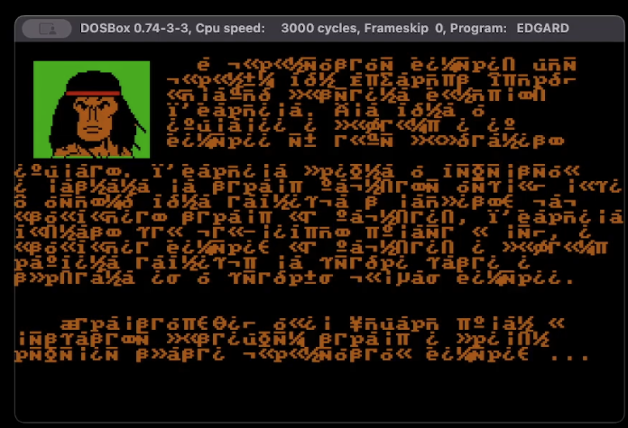

# Original DOS game: story and visual references

Source: the author supplied the original story and three DOSBox screenshots on
2026-10-20. The original DOS game dates to **1994**, as confirmed by the author
and the credits screen: `Copyright 1994 (С) Company MOTO`. The initially supplied
1995 date came from a file timestamp and was corrected by the author.

[Author-supplied playthrough](https://www.youtube.com/watch?v=8hD09QE4U3Q).
The video could not be fetched during this edit; the transcriptions below come from
the attached screenshots, not an asserted review of the video.

## What belongs in the remake now

- README: identify the DOS remake/remaster, give a short world premise and link the
  original playthrough. Keep technical detail in the development documentation.
- Opening (all five supported languages): Rufardus the Wise, L'Kardina's banishment and attempted expulsion,
  eternal night, and the wandering warrior Edgard setting out to save Kimeria. Retain
  the healer as narrator. No collection checklist, ingredients, coins or elixir tutorial.
- Healer: current recipe explanations remain in his encounter. Expanding his story
  using the original seven-component remedy is future work, not part of this revision.
- Portraits: use these original character designs as the primary identity reference
  for the shared PNG portraits in [#90](https://github.com/jlogicgames/edgard_in_kimeria/issues/90);
  see [replacement instructions and author approval](PORTRAITS.md).

Four tablet pieces, seven ingredients and the original four regions are historical
source material. They are not implemented by this text update. The current test build
still has two forest levels. Future campaign ticket
[#94](https://github.com/jlogicgames/edgard_in_kimeria/issues/94) currently specifies
Forest → Swamp → Steppe → Castle; the DOS healer instead names Forest → Castle →
Steppe → Fortress. In the subsequent design discussion on 2026-10-20, the author
explicitly selected Forest → Swamp → Steppe → Fortress, with required tablet
fragments and optional elixir ingredients. This resolves the remake's route choice;
the DOS story below remains historical source material. See
[full campaign design](GAME_DESIGN.md#campaign-structure) and
[D16](DECISIONS.md#d16-expanded-campaign-wind-ladders-and-carried-objects).

## Supplied original story (spelling and punctuation normalized)

В королевстве Кимерия, где правил король Руфардус Мудрый, однажды появилась
колдунья Л'Кардина. Она была изгнана из соседнего королевства, и поэтому из Кимерии
её тоже попытались изгнать. Тогда Л'Кардина пришла в бешенство и наслала на страну
ужасное заклятие. Солнце перестало светить на небосклоне, и всё королевство
погрузилось во мрак. Ведьма имела табличку с заклинанием, которое может освободить
страну от заклятия. Л'Кардина боялась, что кто-нибудь воспользуется волшебным
заклинанием и освободит Кимерию от насланного ею проклятия. Поэтому Л'Кардина
разбила табличку на четыре части и спрятала их в четырёх концах спящей страны.

До странствующего воина по имени Эдгард дошёл слух о несчастье, которое постигло
страну короля Руфардуса. Недолго думая он принял решение отправиться в дальнюю
дорогу, чтобы свергнуть власть чёрной колдуньи и спасти королевство, попавшее в беду.

Путешествуя по незнакомой ему местности, наш искатель неприятностей набрёл на
местного колдуна и знахаря. Старик был этак лет на сто старше вышеназванной
колдуньи и ещё помнил кое-какие старые приёмы против облысения и вечного сна.
От него-то отважный герой и узнал, что ему предстоит пройти: ЛЕС, ЗАМОК, СТЕПЬ
и КРЕПОСТЬ. А также старец поведал Эдгарду о семи компонентах, составляющих
волшебное снадобье, с помощью которого колдун снимет заклятие вечной ночи, ну и,
соответственно, получит небольшое вознаграждение, которое скрасит его одинокую
старость. Правда, какие это компоненты и где они лежат, знахарь на старости лет
забыл. И поэтому их придётся искать самому. Вдоволь наслушавшись советов и
напутствий, нетерпеливый воин отправился дальше…

С этого момента вы начинаете свой долгий и небезопасный путь по стране. Колдунья
не послала вам навстречу ни отвратительных гоблинов, ни кровожадных волков, но это
путешествие не покажется вам послеобеденной прогулкой. На каждом шагу вас будут
поджидать хитроумные ловушки и голодные растения-людоеды. Но это далеко не все
сюрпризы, которые ожидают вас в нелёгком странствии по сонному королевству, а самый
главный и самый трудный из них ожидает вас в самом конце последнего уровня.
Какой? Это вы узнаете, когда полностью пройдёте нашу игру.

## Screenshot transcription

The screenshots display CP866 Cyrillic byte values using western DOS glyphs.
Recovery matched the screenshot glyphs to an IBM BIOS 8×8 font and interpreted the
resulting bytes as CP866. Latin `p` used in place of Cyrillic `р` is normalized below;
paragraphs, spaces and punctuation are made readable. The original screen's
`бешенсево` is rendered as `бешенство`. No new dialogue is inferred from the supplied
longer story. The font reference was used only for decoding, not added to game assets:
[BIOS font collection](https://github.com/viler-int10h/vga-text-mode-fonts).

### 1. Healer



> У кимерийского мудреца, который не заснул, Эдгард узнал, что ему предстоит
> пройти лес, замок, степь и крепость. И он должен собрать 7 составных частей зелья,
> чтобы снять заклятье. Мудрец также предупредил, что колдунья расставила по
> всему его пути множество ловушек. И посоветовал не всегда доверять своим
> глазам.

### 2. Credits and Edgard portrait



```text
Програмист А. Мережаный
Художник П. Мережаный
Музыка Ю. Мережаный

Copyright 1994 (С) Company MOTO
```

`Програмист` is spelled with one `м` on the screen. Initials and surnames are
transcribed as displayed; full names are not supplied or inferred.

### 3. Edgard and the world story



> В королевстве Кимерия, где королём был Руфардус Мудрый, однажды посетила колдунья
> Л'Кардина. Она была в изгнании, и поэтому и из Кимерии её тоже попытались
> изгнать. Л'Кардина пришла в бешенство и наслала на страну заклятье вечной ночи.
> У ведьмы была табличка с надписью, как освободить страну от заклятия. Л'Кардина
> боялась, что кто-нибудь узнает о ней и освободит Кимерию от заклятия, и поэтому
> разбила табличку на четыре части и спрятала их в четырёх концах Кимерии.
>
> Странствующий воин Эдгард узнал о несчастье, постигшем страну, и принял
> решение спасти королевство Кимерию…

## Portrait direction for #90

The author clarified the remake/remaster direction on 2026-10-22: preserve the original
artist's style while improving beauty, naturalness, color richness and fine detail.
Use these references for character identity and drawing language; the green background,
DOSBox frame and coarse hardware limitations do not belong in the new portraits.
See [art direction](ART_DIRECTION.md).

- **Edgard:** long black hair, a narrow red headband across the forehead, a stern,
  angular clean-shaven face, strong dark brows, warm ochre skin and visible shoulders.
  Preserve the headband/hair silhouette and determined expression in a small portrait.
- **Healer:** a visibly old man, balding on top, with a very long ochre beard and
  moustache, warm brown/ochre clothing, and a staff beside him with a red hooked top.
  Preserve his age, beard, staff and silhouette; do not substitute a generic hooded wizard.
- Draw separate transparent image assets sized for the existing dialogue frames;
  retain clean contours, aspect ratio and recognition at the actual display size.
  The current portrait baseline is 256 × 256 px with up to 256 colors and smooth filtering.
- Use the same character identities before/after the boss and during pause. This is
  portrait work; gameplay animation sprites remain outside #90.
- Author artwork review should compare the new portraits directly with these references.


## Opening-text validation — 2026-10-20

The EN/UK opening-text change described below is now included in the game. The
following records the earlier text/layout validation; the current verification is
recorded separately below.

All 130 core tests passed; desktop and TeaVM release web builds succeeded. A temporary
hidden-window LWJGL harness rendered the new EN/UK opening using the actual baked
QuestSquare-15 font and the same Overlay.body path as the game. Both translations
have all required glyphs and fit the 512-pixel text width; each layout is 217 pixels
high and scrolls through in about 24 seconds, plus the existing fades. Both captured
layouts were visually inspected. No dialogue timing/input or save logic changed.
This was text/layout validation, not a new human playthrough or browser visual check.
The temporary harness was removed after use. Snyk scanning was rejected by automatic
approval review because it could disclose source to an external service; no scan result
is claimed.


### Verification for the committed opening text — 2026-10-20

The core suite now passes **131 tests**, with zero failures/errors/skips;
`buildDesktop` and the TeaVM release `buildWeb` also succeed. A temporary metric
check used the actual baked QuestSquare-15 font data and libGDX `GlyphLayout`
with the same wrapping/alignment as `Overlay.body`. At a 512 px wrap width,
the EN opening is 511 × 217 px and UK is 498 × 217 px; all glyphs are present.
At the 312 px About panel width, the shortened rules are 296 × 37 px (EN) and
299 × 52 px (UK), also with complete glyphs. This check measures font layout
without rendering; it is not a new desktop/browser visual or human playthrough.
The temporary checker was removed. The shipped change consists only of localized
string values; no input, dialogue timeline, save, dependency or executable logic
was added. Security review was local, consistent with the existing choice above.
